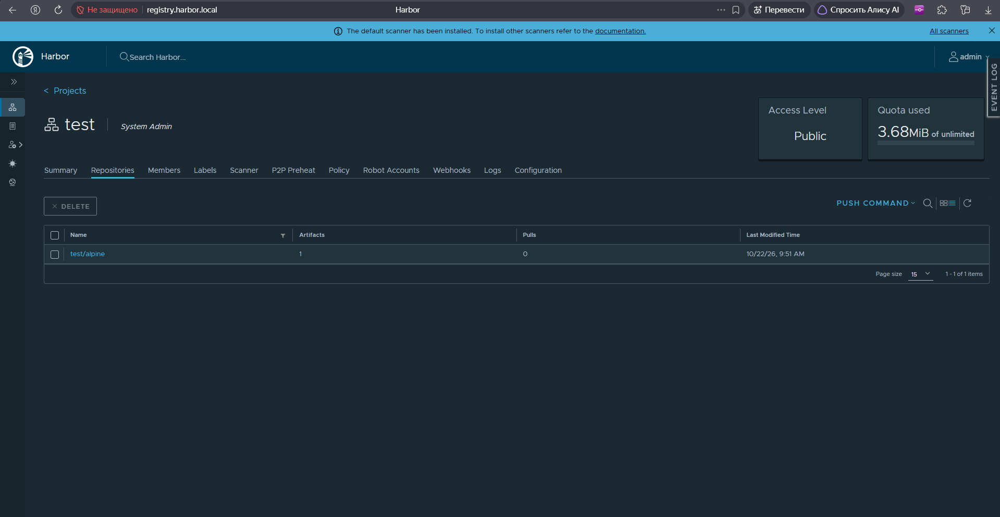
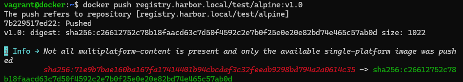

# Laboratory: Harbor, Docker, Falco, Rsyslog
Этот репозиторий содержит документацию и конфигурацию для тестового стенда.
## Архитектура

Стенд состоит из двух виртуальных машин в приватной сети:

1. **`harbor.local` (192.168.56.11)** — 4 GB RAM, 2 CPU.
   - Приватный реестр образов (Harbor).
   - Сканер уязвимостей (Trivy).
   - (В планах) Falco и Rsyslog.
2. **`docker.local` (192.168.56.12)** — 2 GB RAM, 1 CPU.
   - Docker Engine (клиент).
   - (В планах) Falco и Rsyslog.

## Используемые версии

- **Vagrant:** 2.4.9
- **VirtualBox:** 7.2
- **OS:** Ubuntu 24.04 LTS (bento/ubuntu-24.04)
- **Docker Engine:** 29.1.3
- **Docker Compose:** 2.40.3
- **Harbor:** v2.14.2

## Быстрый старт (как поднять заново)

1. Убедитесь, что установлены Vagrant и VirtualBox.
2. Склонируйте репозиторий.
3. Выполните `vagrant up` (поднимутся обе ВМ).
4. Пропишите в `/etc/hosts` на ВМ и на вашем ПК:
   ```text
   192.168.56.11 registry.harbor.local
   192.168.56.12 docker.local
   

- [x] Созданы 2 ВМ (Ubuntu 24.04) через Vagrant.
- [x] Настроена сеть и пропиcаны /etc/hosts на всех узлах.
- [x] Установлен Docker и Docker Compose на ВМ harbor.
- [x] Сгенерированы TLS-сертификаты (CA, harbor.crt, harbor.key).
- [x] Установлен Harbor (v2.14.2) с Trivy. Доступен по адресу https://registry.harbor.local.

- [x] Настроен Docker на ВМ `docker`.
- [x] Настроено доверие к сертификату Harbor.
- [x] Создан проект `test` в Harbor.
- [x] Выполнен первый успешный `docker push` (образ alpine:v1.0).


