# Laboratory: Harbor, Docker, Falco, Rsyslog
Этот репозиторий содержит документацию и конфигурацию для тестового стенда.
## Архитектура
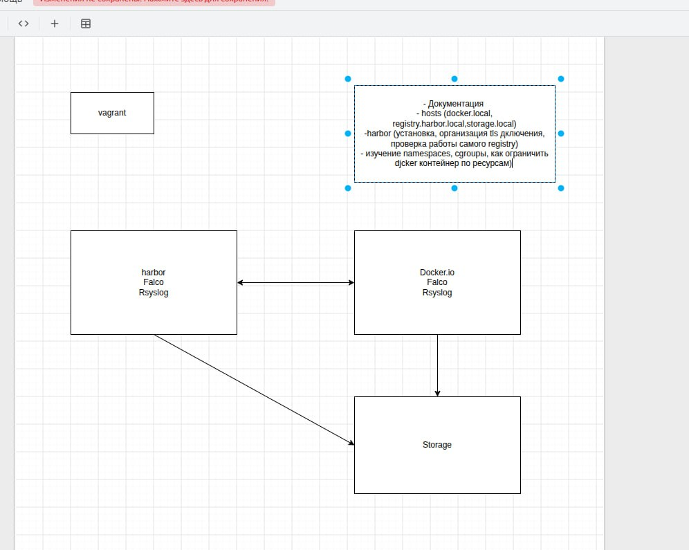
Стенд состоит из двух виртуальных машин в приватной сети:

1. **`harbor.local` (192.168.56.11)** — 4 GB RAM, 2 CPU.
   - Приватный реестр образов (Harbor).
   - Сканер уязвимостей (Trivy).
   - (В планах) Falco и Rsyslog.
2. **`docker.local` (192.168.56.12)** — 2 GB RAM, 1 CPU.
   - Docker Engine (клиент).
   - Falco и Rsyslog.

## Используемые версии

- **Vagrant:** 2.4.9
- **VirtualBox:** 7.2
- **OS:** Ubuntu 24.04 LTS (bento/ubuntu-24.04)
- **Docker Engine:** 29.1.3
- **Docker Compose:** 2.40.3
- **Harbor:** v2.14.2

## Быстрый старт (как поднять заново)

## 🚀 Быстрый старт (как поднять заново)

1. Убедитесь, что установлены Vagrant и VirtualBox.
2. Склонируйте репозиторий.
3. Выполните `vagrant up` (поднимутся **три** ВМ: `harbor`, `docker`, `storage`).
4. **Если при установке пакетов возникает ошибка `Temporary failure resolving`**, выполните фикс DNS на всех ВМ (см. [docs/00-dns-fix.md](docs/00-dns-fix.md)).
5. Пропишите в `/etc/hosts` на **всех трех ВМ** (и на вашем ПК для доступа к веб-интерфейсу):
	```text
	192.168.56.10 storage.local
	192.168.56.11 registry.harbor.local
	192.168.56.12 docker.local 
	```
6. Настройте NFS-хранилище на ВМ storage и подключите его к Harbor (см. docs/03-storage-nfs.md) *Необходимо далее для storage.local.
7. На ВМ harbor: установите Docker, сгенерируйте TLS-сертификаты, установите и запустите Harbor (см. docs/01-harbor-setup.md).
8. На ВМ docker: установите Docker, настройте доверие к сертификату и сделайте первый docker push (см. docs/02-docker-client-setup.md).
9. На обоих ВМ: установите Falco и добавьте репозиторий (см. docs/04-falco_setup.md).
10. На обоих ВМ: установите Rsyslog, настройте ВМ Harbor на сбор логов, ВМ Docker на отправку (см. docs/05-rsyslog-setup.md).

- [x] Созданы 2 ВМ (Ubuntu 24.04) через Vagrant.
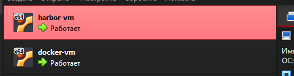
- [x] Настроена сеть и пропиcаны /etc/hosts на всех узлах.
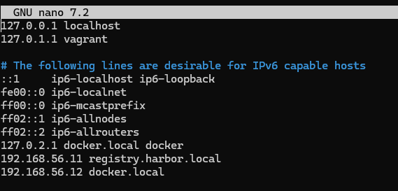
- [x] Установлен Docker и Docker Compose на ВМ harbor.
- [x] Сгенерированы TLS-сертификаты (CA, harbor.crt, harbor.key).
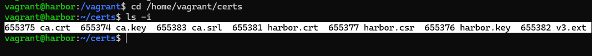
- [x] Установлен Harbor (v2.14.2) с Trivy. Доступен по адресу https://registry.harbor.local.
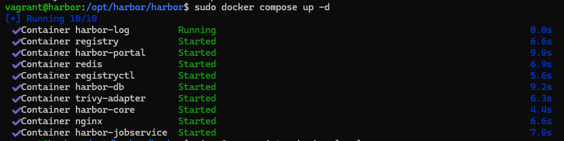
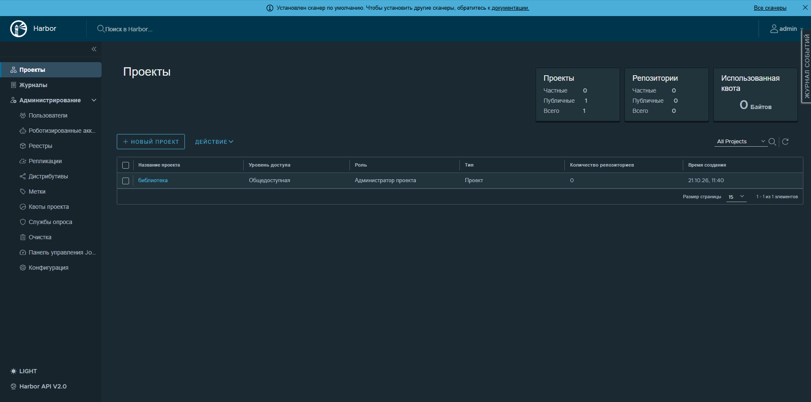
- [x] Настроен Docker на ВМ `docker`.
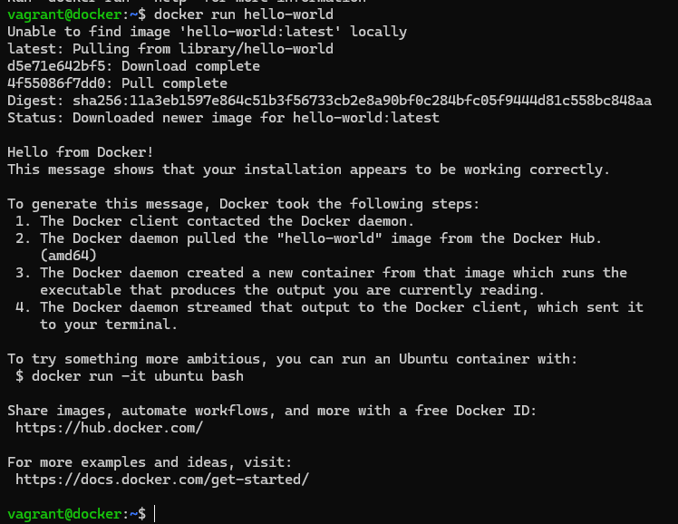
- [x] Настроено доверие к сертификату Harbor.
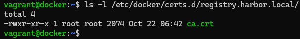
- [x] Создан проект `test` в Harbor.
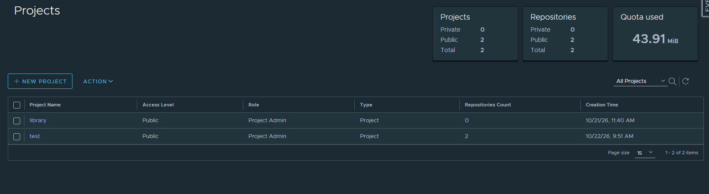
- [x] Выполнен первый успешный `docker push` (образ alpine:v1.0).
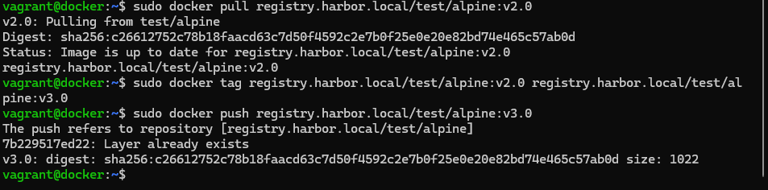
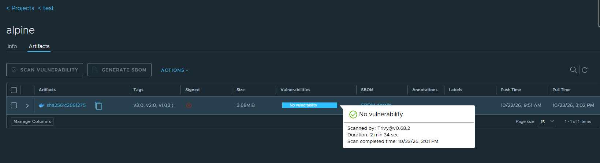
- [x] Установлен и испытан Falco 
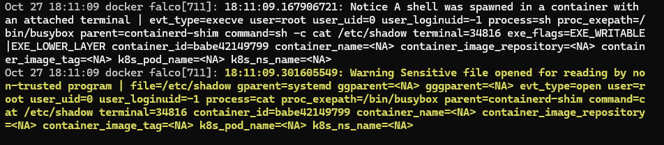
- [x] Установлен и испытан Rsyslog
.png)

##  Функционал Harbor по защите контейнеризации

- **Подпись образов (Cosign):**
Для чего используют: Чтобы гарантировать, что образ не был подменен или изменен злоумышленником.
Как это работает: 
1. Разработчик создает образ и подписывает его своим приватным ключом (как ставит личную печать).
2. Подпись сохраняется в Harbor рядом с образом .
3. Когда кто-то пытается скачать (pull) этот образ, Harbor проверяет печать. Если образ был изменен после подписи, печать сломается, и Harbor заблокирует скачивание.
4. Если влючен Cosign, Harbor разрешает скачивать только образы с подтвержденной-подписью. Неподписанные образы (как ubuntu в примере) скачать будет нельзя .
 Настроена проверка подписей. Образ `alpine` подписан ключом Cosign, в Harbor включен режим `Cosign` (Content Trust). 
  *Проверка:* Попытка скачать неподписанный образ `ubuntu` завершается ошибкой `signature not found`.
  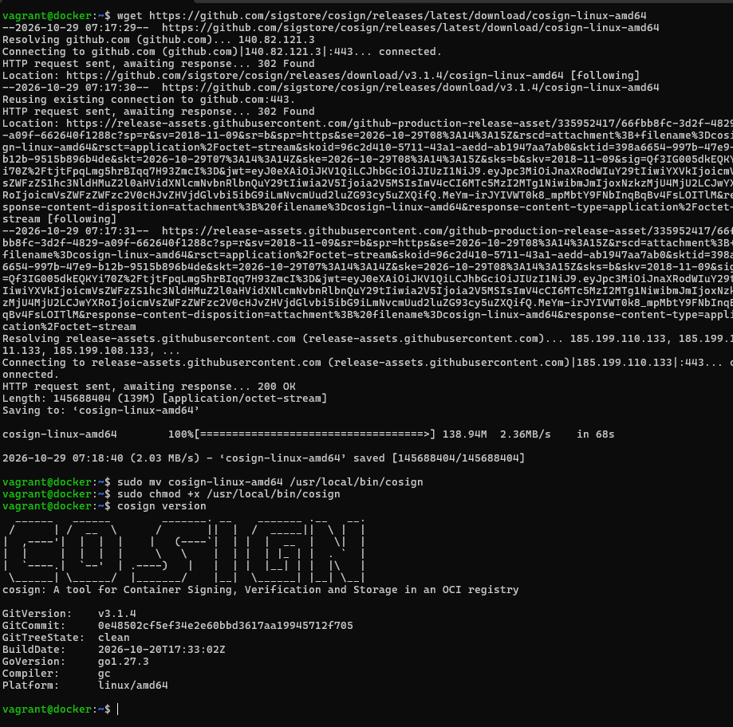
  
  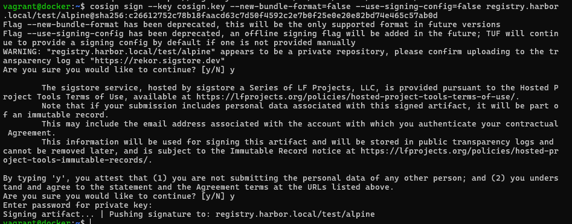)
  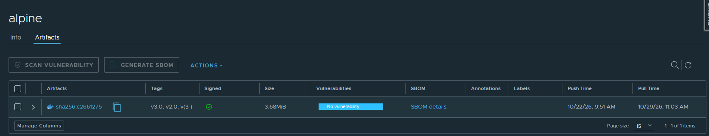
  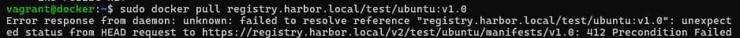
  *Примечание:* Из-за бага совместимости Cosign 3.x и Harbor 2.14 подпись пришлось создавать с флагами `--new-bundle-format=false --use-signing-config=false`, чтобы иконка отображалась в UI.

- **Блокировка уязвимых образов:** 
Для чего используют: Чтобы не дать запустить (или скачать) образ, в котором есть известные дыры в безопасности (CVE).
Как это работает:
1. Trivy сканирует образ и находит уязвимости (например, в старой версии библиотеки).
2. Ты в настройках проекта выбираешь порог (например, High).
3. Если в образе есть уязвимость уровня High или Critical, Harbor запрещает его скачивание (pull) .
4. Разработчик будет вынужден обновить библиотеку, пересобрать образ и запушить его заново.
В настройках проекта включена опция `Prevent vulnerable images from running` (уровень `Low` и выше).
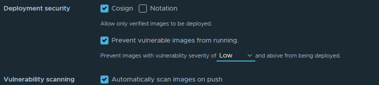