# Laboratory: Harbor, Docker, Falco, Rsyslog
Этот репозиторий содержит документацию и конфигурацию для тестового стенда.
- **docs:** Указания по установке и подготовке тестового стенда.
- **docs_harbor:** Указания по установке доп. возможностей для харбор, предусмотренных сообществом.
## Архитектура
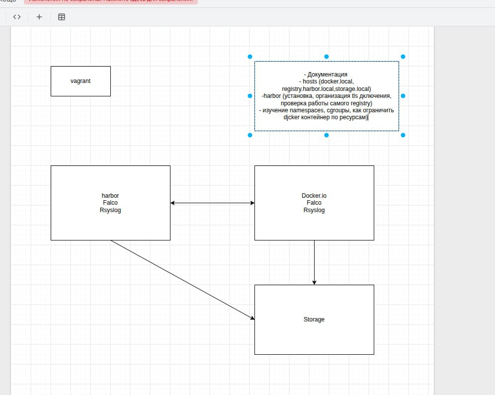
Стенд состоит из двух виртуальных машин в приватной сети:

1. **`harbor.local` (192.168.56.11)** — 4 GB RAM, 2 CPU.
   - Приватный реестр образов (Harbor).
   - Сканер уязвимостей (Trivy).
   - (В планах) Falco и Rsyslog.
2. **`docker.local` (192.168.56.12)** — 2 GB RAM, 1 CPU.
   - Docker Engine (клиент).
   - Falco и Rsyslog.

## Используемые версии

- **Vagrant:** 2.4.9
- **VirtualBox:** 7.2
- **OS:** Ubuntu 24.04 LTS (bento/ubuntu-24.04)
- **Docker Engine:** 29.1.3
- **Docker Compose:** 2.40.3
- **Harbor:** v2.14.2

## Быстрый старт (как поднять заново)

## 🚀 Быстрый старт (как поднять заново)

1. Убедитесь, что установлены Vagrant и VirtualBox.
2. Склонируйте репозиторий.
3. Выполните `vagrant up` (поднимутся **три** ВМ: `harbor`, `docker`, `storage`).
4. **Если при установке пакетов возникает ошибка `Temporary failure resolving`**, выполните фикс DNS на всех ВМ (см. [docs/00-dns-fix.md](docs/00-dns-fix.md)).
5. Пропишите в `/etc/hosts` на **всех трех ВМ** (и на вашем ПК для доступа к веб-интерфейсу):
	```text
	192.168.56.10 storage.local
	192.168.56.11 registry.harbor.local
	192.168.56.12 docker.local 
	```
6. Настройте NFS-хранилище на ВМ storage и подключите его к Harbor (см. docs/03-storage-nfs.md) *Необходимо далее для storage.local.
7. На ВМ harbor: установите Docker, сгенерируйте TLS-сертификаты, установите и запустите Harbor (см. docs/01-harbor-setup.md).
8. На ВМ docker: установите Docker, настройте доверие к сертификату и сделайте первый docker push (см. docs/02-docker-client-setup.md).
9. На обоих ВМ: установите Falco и добавьте репозиторий (см. docs/04-falco_setup.md).
10. На обоих ВМ: установите Rsyslog, настройте ВМ Harbor на сбор логов, ВМ Docker на отправку (см. docs/05-rsyslog-setup.md).

- [x] Созданы 2 ВМ (Ubuntu 24.04) через Vagrant.
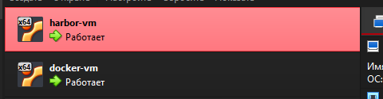
- [x] Настроена сеть и пропиcаны /etc/hosts на всех узлах.
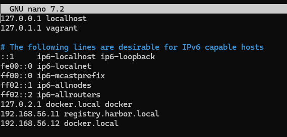
- [x] Установлен Docker и Docker Compose на ВМ harbor.
- [x] Сгенерированы TLS-сертификаты (CA, harbor.crt, harbor.key).
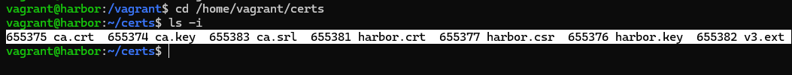
- [x] Установлен Harbor (v2.14.2) с Trivy. Доступен по адресу https://registry.harbor.local.
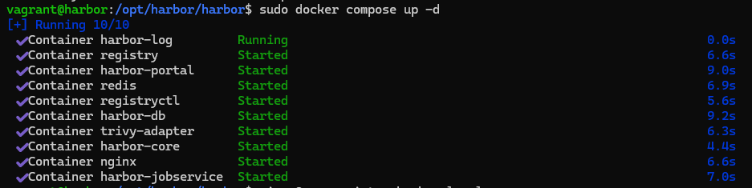
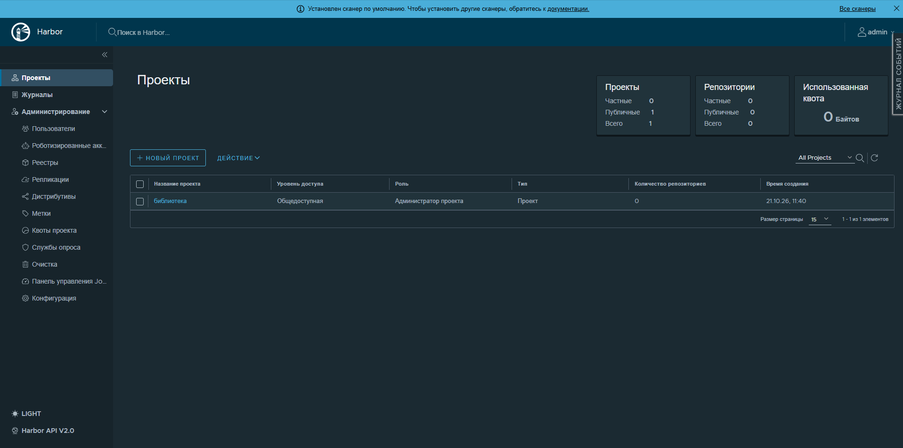
- [x] Настроен Docker на ВМ `docker`.
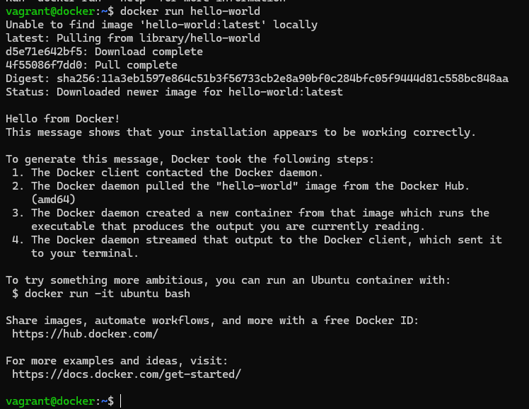
- [x] Настроено доверие к сертификату Harbor.
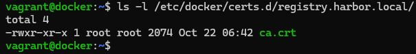
- [x] Создан проект `test` в Harbor.
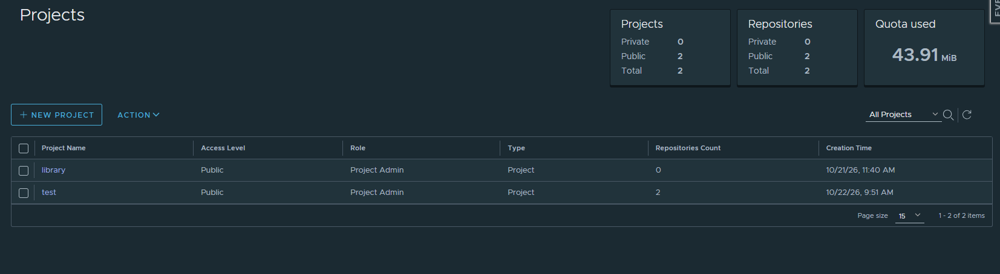
- [x] Выполнен первый успешный `docker push` (образ alpine:v1.0).
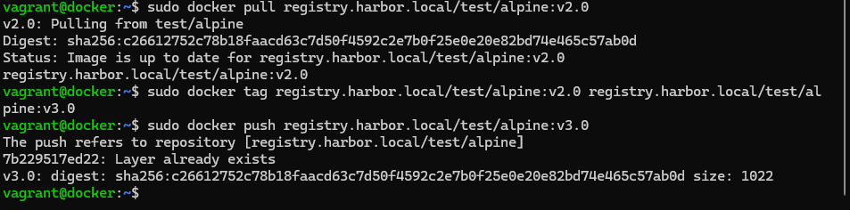
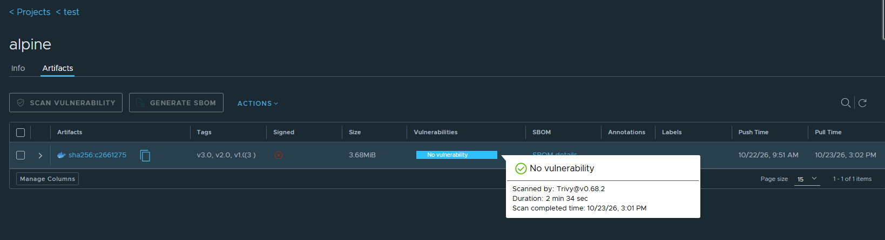
- [x] Установлен и испытан Falco 
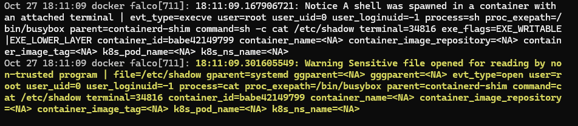
- [x] Установлен и испытан Rsyslog
.png)

##  Функционал Harbor по защите контейнеризации

##  Подпись образов (Cosign):
Для чего используют: Чтобы гарантировать, что образ не был подменен или изменен злоумышленником.
Как это работает: 
1. Разработчик создает образ и подписывает его своим приватным ключом (как ставит личную печать).
2. Подпись сохраняется в Harbor рядом с образом .
3. Когда кто-то пытается скачать (pull) этот образ, Harbor проверяет печать. Если образ был изменен после подписи, печать сломается, и Harbor заблокирует скачивание.
4. Если влючен Cosign, Harbor разрешает скачивать только образы с подтвержденной-подписью. Неподписанные образы (как ubuntu в примере) скачать будет нельзя .
 Настроена проверка подписей. Образ `alpine` подписан ключом Cosign, в Harbor включен режим `Cosign` (Content Trust). 
  *Проверка:* Попытка скачать неподписанный образ `ubuntu` завершается ошибкой `signature not found`.
  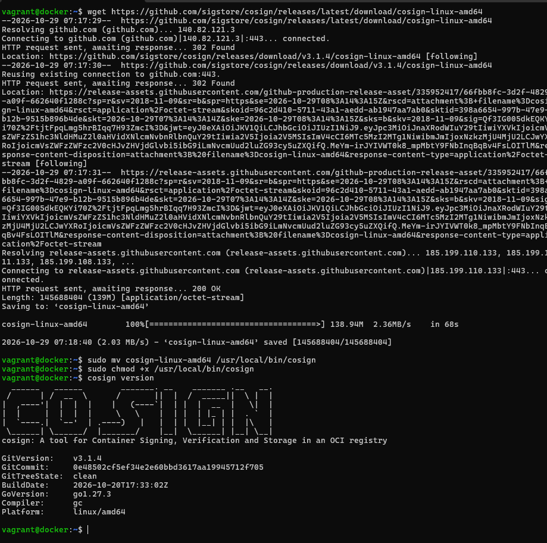
  
  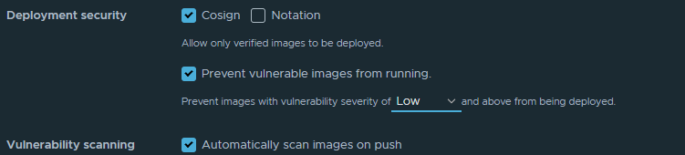
  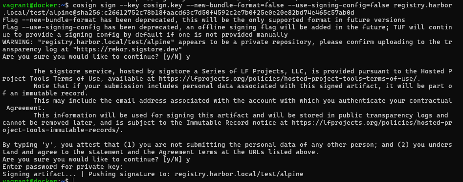)
  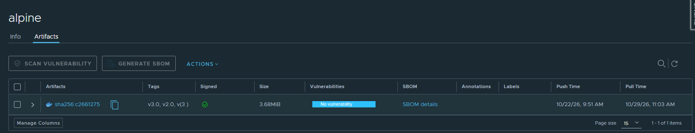
  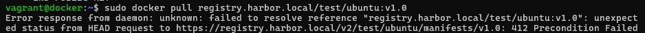
  *Примечание:* Из-за бага совместимости Cosign 3.x и Harbor 2.14 подпись пришлось создавать с флагами `--new-bundle-format=false --use-signing-config=false`, чтобы иконка отображалась в UI.

## Блокировка уязвимых образов:
Для чего используют: Чтобы не дать запустить (или скачать) образ, в котором есть известные дыры в безопасности (CVE).
Как это работает:
1. Trivy сканирует образ и находит уязвимости (например, в старой версии библиотеки).
2. Ты в настройках проекта выбираешь порог (например, High).
3. Если в образе есть уязвимость уровня High или Critical, Harbor запрещает его скачивание (pull) .
4. Разработчик будет вынужден обновить библиотеку, пересобрать образ и запушить его заново.
В настройках проекта включена опция `Prevent vulnerable images from running` (уровень `Low` и выше).
Попытка скачать уязвимый образ завершается ошибкой `412 Precondition Failed`, что подтверждает работу политики `Prevent vulnerable images from running`

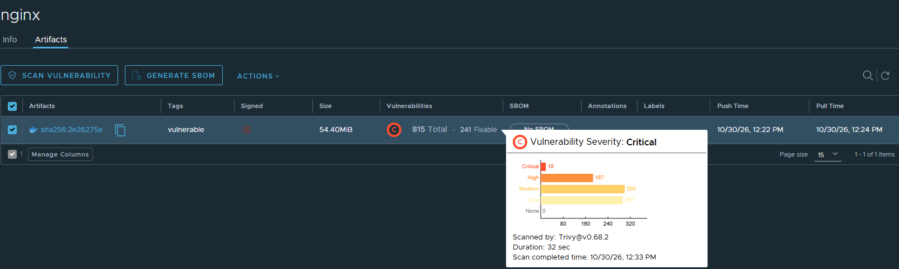
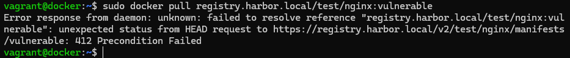

## Управление доступом (RBAC):

В Harbor рассмотрено разграничение прав на основе ролей.

- **Матрица прав доступа (RBAC) по ролям в Harbor**

В Harbor разграничение прав происходит на уровне проекта. Ниже приведено описание ролей и их ключевые возможности (на основе официальной документации Harbor v2.14) .

- **Краткое описание ролей (от меньших прав к большим)**

*   **Limited Guest (Ограниченный гость):** Может только скачивать (pull) образы. Не видит логи проекта и список участников. Идеально для внешних подрядчиков или автоматизированных систем, которым нужно только забирать образы .
*   **Guest (Гость):** Имеет права только на чтение. Может скачивать (pull) и перетегировать (retag) образы, но не может ничего загружать (push) .
*   **Developer (Разработчик):** Имеет права на чтение и запись. Может загружать (push) и скачивать образы. **Не может** удалять образы или менять настройки безопасности проекта (сканирование, подписи).
*   **Maintainer (Сопровождающий):** Расширенные права. Может всё, что Developer, а также **сканировать образы**, просматривать задачи репликации и **удалять** образы/Helm-чарты .
*   **Project Admin (Администратор проекта):** Полный контроль над проектом. Может редактировать конфигурацию проекта, **добавлять/удалять участников**, запускать сканирование и удалять проект целиком .

- **Таблица ключевых разрешений**

| Действие | Limited Guest | Guest | Developer | Maintainer | Project Admin |
| :--- | :---: | :---: | :---: | :---: | :---: |
| Просмотр списка образов | ✓ | ✓ | ✓ | ✓ | ✓ |
| **Скачивание (Pull) образов** | ✓ | ✓ | ✓ | ✓ | ✓ |
| Перетегирование (Retag) | | ✓ | ✓ | ✓ | ✓ |
| **Загрузка (Push) образов** | | | ✓ | ✓ | ✓ |
| **Сканирование / Удаление образов** | | | | ✓ | ✓ |
| Создание/удаление правил тегов | | | | ✓ | ✓ |
| Просмотр логов проекта | | | ✓ | ✓ | ✓ |
| **Редактирование настроек проекта** | | | | | ✓ |
| **Управление участниками (Members)** | | | | | ✓ |
| Удаление проекта | | | | | ✓ |

*(Примечание: Системный администратор `admin` имеет все права на всё, независимо от проекта).*

- **Системные роли (вне проектов)**

*   **Harbor System Administrator (Системный администратор):** Может создавать/удалять пользователей, назначать других админов, видеть все проекты и управлять глобальными политиками сканирования .
*   **Anonymous (Анонимный пользователь):** Пользователь, который не залогинился. Не имеет доступа к приватным проектам. В публичных проектах может только просматривать и скачивать образы .

1. Создан пользователь `dev1` с ролью **Developer**.
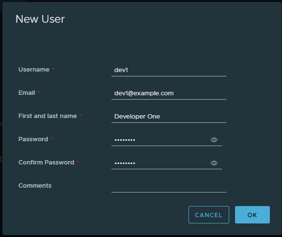
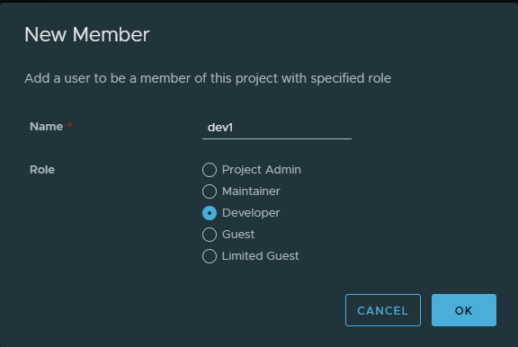
2. Роль **Developer** позволяет загружать (push) и скачивать (pull) образы в проекте `test`, но **не позволяет** изменять настройки безопасности проекта (Configuration), удалять проект или управлять другими пользователями.
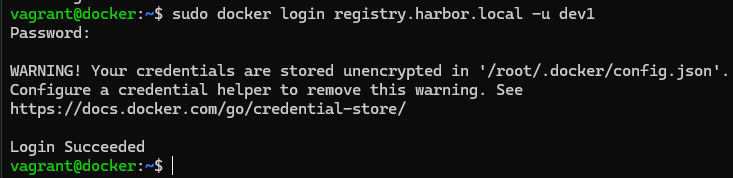
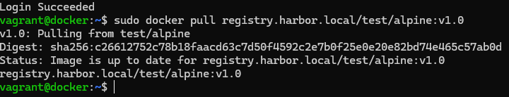
3. Проверено: при входе под `dev1` вкладка `Configuration` недоступна для редактирования, а попытка изменить политики безопасности завершается ошибкой `403 Forbidden`.
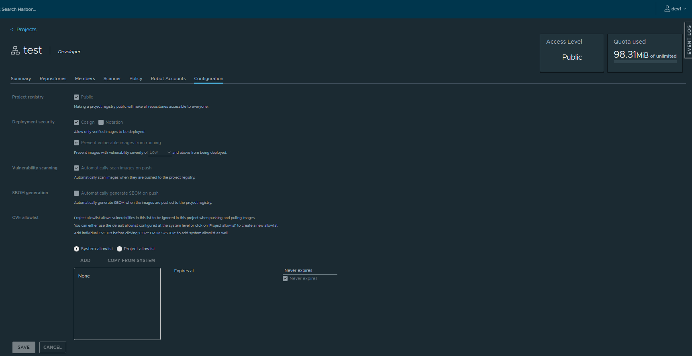

## Неизменяемость тегов (Tag Immutability)

Для защиты от перезаписи релизных версий в проекте `test` включено правило неизменяемости для всех тегов (`**`).
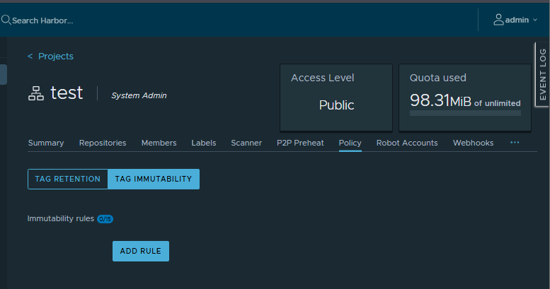
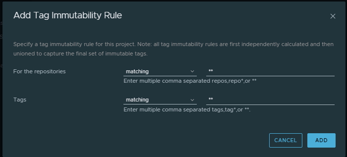
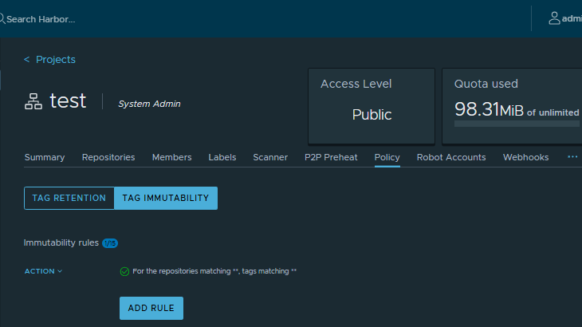

**Проверка:** Попытка перезаписать существующий тег (`alpine:v1.0`) другим образом завершается ошибкой `configured as immutable.`. Это гарантирует, что под одним и тем же тегом всегда лежит один и тот же образ.
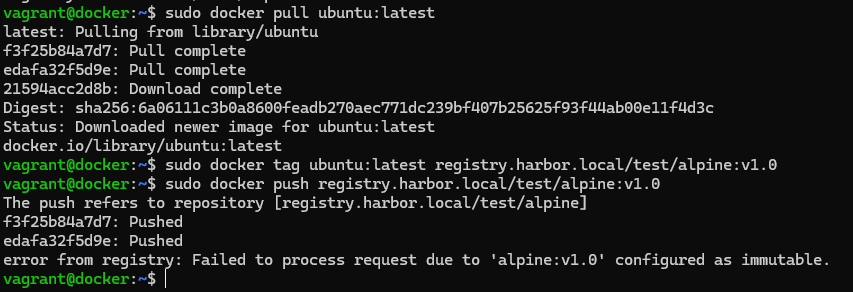

## Квоты на проекты (Project Quotas)

Для проверки механизма квот был создан отдельный проект `quota-test` с лимитом 10 MiB.
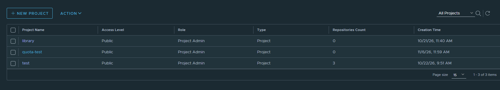
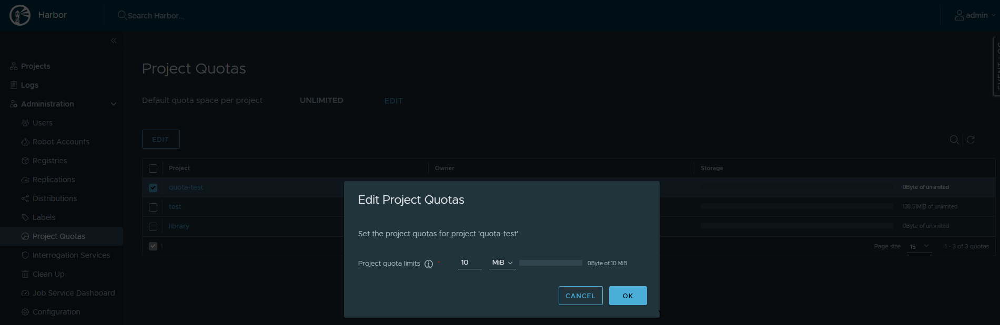

**Проверка:** Попытка запушить образ `nginx` (24.4 МБ) в проект `quota-test` завершилась ошибкой `error from registry: adding 24.4 MiB of storage resource, which when updated to current usage of 0 B will exceed the configured upper limit of 10.0 MiB.`. Harbor заблокировал загрузку, так как образ превышает установленный лимит. Это подтверждает работу защиты диска от переполнения.
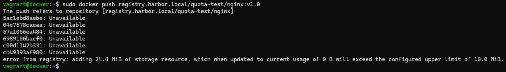

## Политики очистки (Retention)

Для автоматического удаления старых образов в проекте `test` настроено правило Retention:
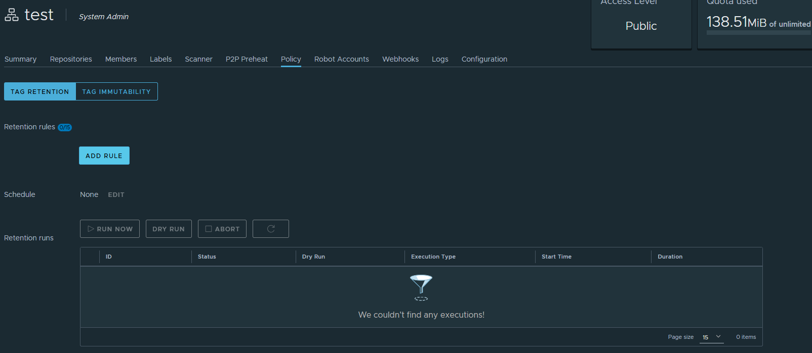
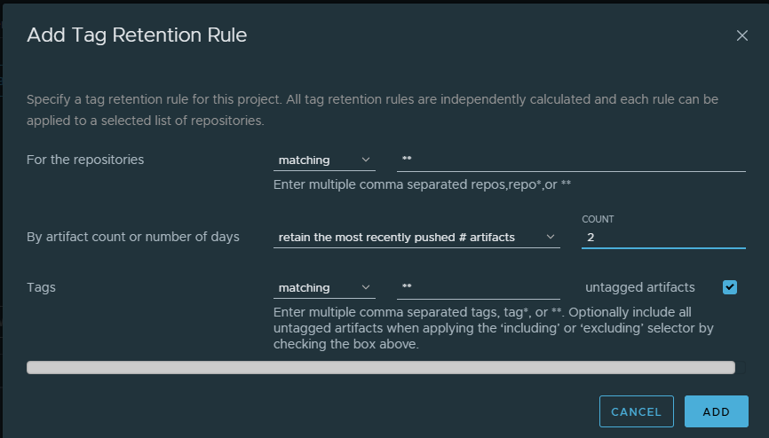
- **Repository:** `**` (все репозитории)
- **Quantity to retain:** `2` (оставлять только 2 последних тега)
- **Schedule:** вручную

**Проверка:** Выполнен `Dry Run` 
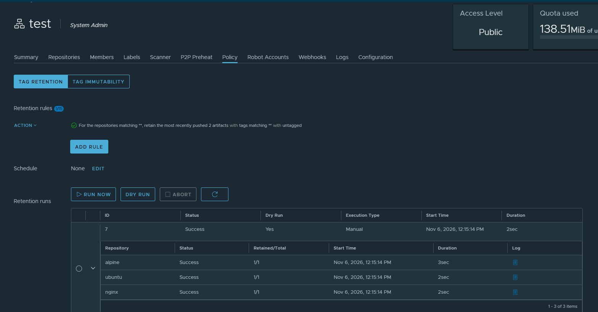
который показал, что Harbor удалит старые теги (например, `alpine:v1.0`). 
После реального запуска правила: 
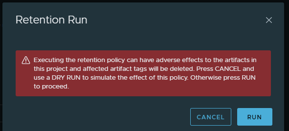 старый тег был удален, что подтверждает работу автоочистки.
Также возможен просмотр логов:
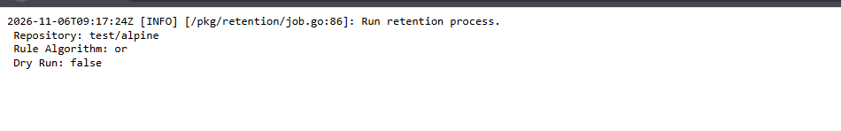